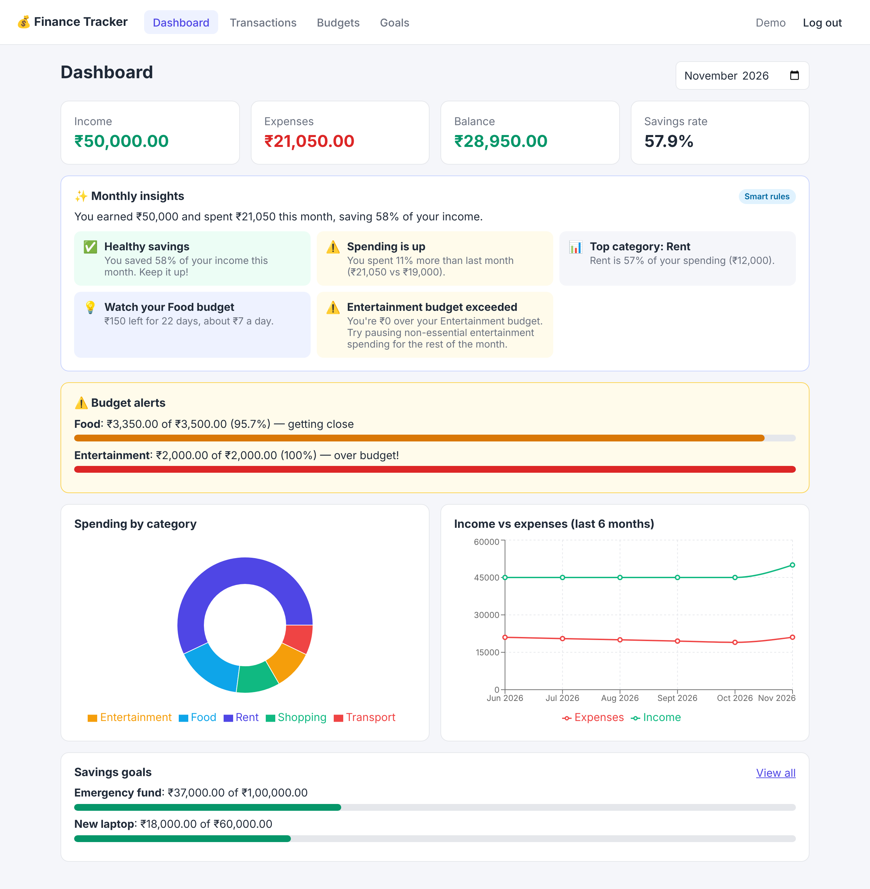
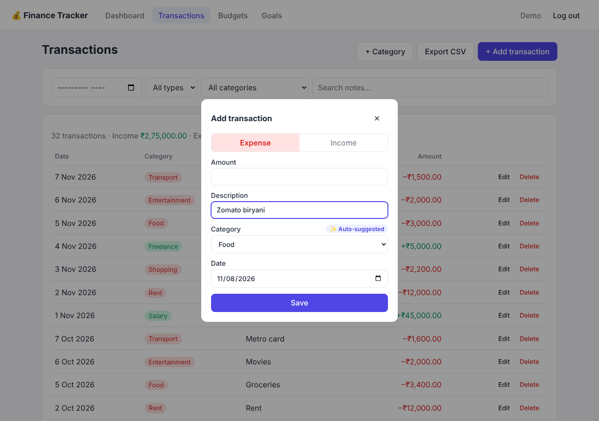
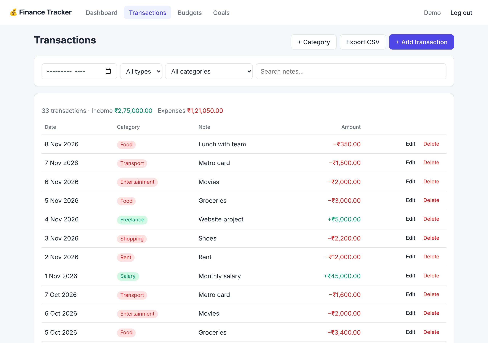
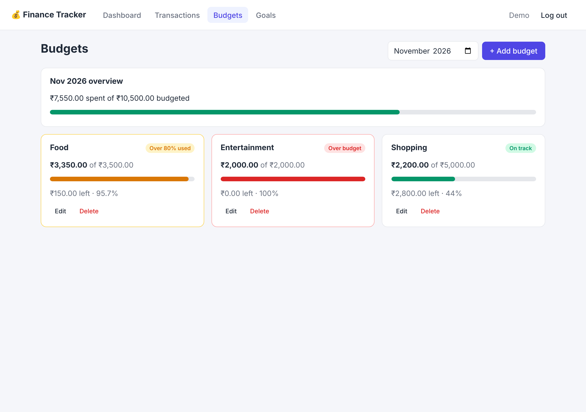
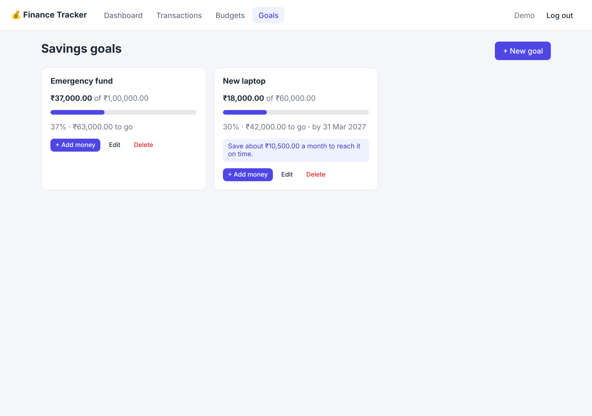
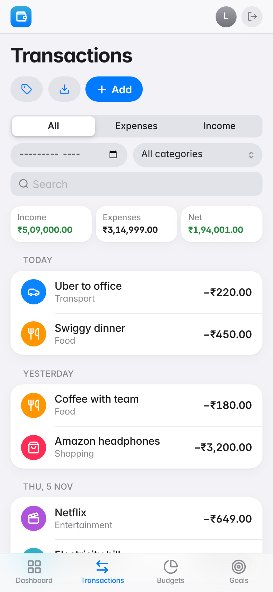
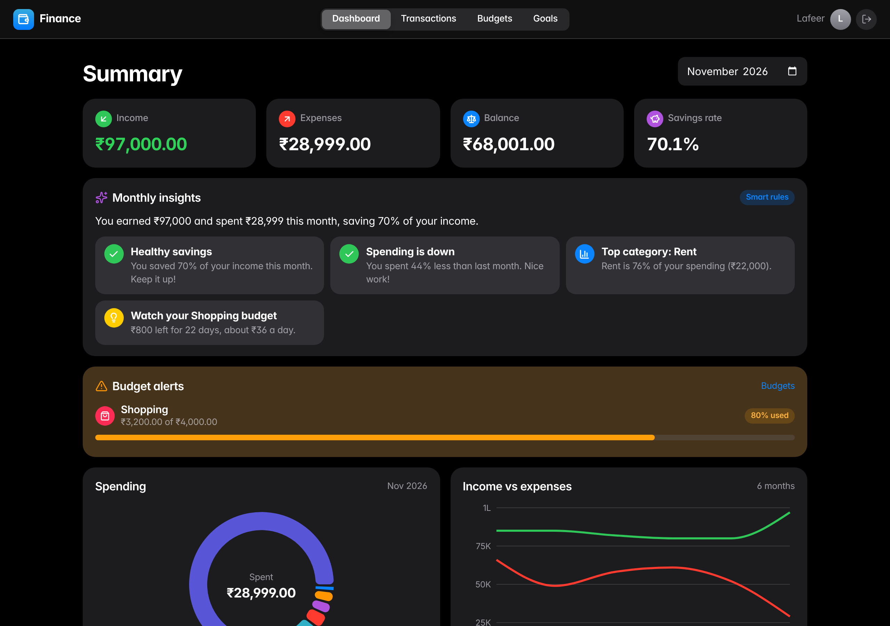
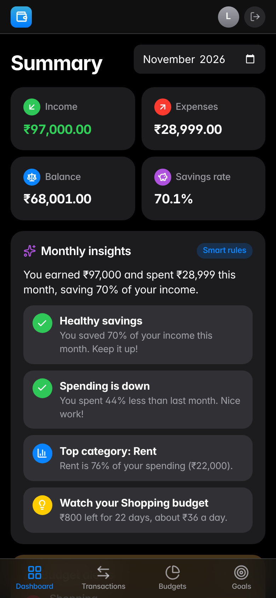

# Personal Finance Tracker

A full stack web app to record income and expenses, set monthly budgets, see spending patterns, and track savings goals.

**Stack:** React (Vite) · FastAPI · SQLAlchemy · SQLite · JWT auth · Recharts · Claude API (optional)



## Features

- **Accounts:** sign up and log in. Passwords are hashed with bcrypt and sessions use JWT tokens. Each user only ever sees their own data.
- **Transactions:** add, edit and delete income and expenses with an amount, date, category and note. Filter by month, type, category, or search notes. Export to CSV.
- **Categories:** sensible defaults are created at sign up (Food, Rent, Salary…), and you can add your own.
- **Budgets:** set a monthly limit per expense category. Each budget shows how much is spent and turns amber at 80% and red when you go over. Alerts also show on the dashboard.
- **Dashboard:** monthly income, expenses, balance and savings rate; a donut chart of spending by category; a 6‑month income vs expenses trend line.
- **Savings goals:** set a target and optional deadline, add money over time, and see progress plus how much you need to save each month to finish on time.
- **✨ Auto-categorize (AI):** type a description like "Zomato biryani" or "Uber to office" and the category is filled in for you. It also learns from how you categorized past transactions.
- **✨ Monthly insights (AI):** the dashboard shows a short summary of your month and personalised tips: spending changes vs last month, categories that jumped, budgets at risk (with a daily allowance), savings rate, and whether you're on track for your goals.

## AI features and the API key

Both AI features work **out of the box with no API key**, using a built-in rules engine (keyword lists, your own transaction history, and month-over-month calculations). The dashboard shows a **Smart rules** badge in this mode.

To have Claude write the insights and pick categories, set an Anthropic API key before starting the backend. The badge then shows **AI**.

```bash
# macOS/Linux
export ANTHROPIC_API_KEY=sk-ant-...
# Windows PowerShell
$env:ANTHROPIC_API_KEY="sk-ant-..."
```

Get a key at https://console.anthropic.com. If a Claude request fails for any reason (no network, rate limit), the app falls back to the rules engine, so it never breaks. Insights are cached per month until your data changes, so reloading the dashboard doesn't call the API again. The code lives in `backend/app/ai.py`.



## Project structure

```
backend/
  app/
    main.py          FastAPI app, CORS, router registration
    config.py        settings (secret key, database URL) from environment variables
    database.py      SQLAlchemy engine and session
    models.py        database tables: User, Category, Transaction, Budget, Goal
    schemas.py       Pydantic models that validate requests and shape responses
    security.py      password hashing, JWT creation, current-user dependency
    services.py      shared logic: budget status, goal progress, default categories
    ai.py            AI features: Claude calls + offline rules fallback
    routers/         one file per feature: auth, categories, transactions, budgets, goals, dashboard, ai
  tests/             pytest API tests (in-memory database)
  requirements.txt
frontend/
  src/
    api.js           axios client that attaches the token
    AuthContext.jsx  login state shared across the app
    App.jsx          routes
    components/      Layout (nav bar), Modal, ProgressBar
    pages/           Login, Register, Dashboard, Transactions, Budgets, Goals
    format.js        currency and date helpers (change currency here)
```

## Running it locally

You need **Python 3.10+** and **Node.js 18+**.

### 1. Backend

```bash
cd backend
python -m venv .venv
# Windows: .venv\Scripts\activate      macOS/Linux: source .venv/bin/activate
pip install -r requirements.txt
uvicorn app.main:app --reload
```

The API runs at http://localhost:8000. Interactive API docs are at **http://localhost:8000/docs**: click *Authorize*, enter your email as the username and your password, and you can try every endpoint.

The SQLite database file `finance.db` is created automatically the first time the server starts.

### 2. Frontend

In a second terminal:

```bash
cd frontend
npm install
npm run dev
```

Open http://localhost:5173 and create an account.

If the backend runs somewhere other than `http://localhost:8000`, copy `.env.example` to `.env` and change `VITE_API_URL`.

### 3. Tests

```bash
cd backend
pytest
```

## API overview

All endpoints except register and login need an `Authorization: Bearer <token>` header.

| Method | Path | Description |
|---|---|---|
| POST | `/auth/register` | Create an account, returns a token |
| POST | `/auth/login` | Log in (form fields `username` = email, `password`) |
| GET | `/auth/me` | Current user |
| GET / POST | `/categories` | List (optional `type`) / create |
| DELETE | `/categories/{id}` | Delete an unused category |
| GET / POST | `/transactions` | List with filters `month`, `type`, `category_id`, `start`, `end`, `search` / create |
| GET / PUT / DELETE | `/transactions/{id}` | Read / update / delete |
| GET | `/transactions/export` | Download CSV (same filters) |
| GET / POST | `/budgets` | List for a `month` with spent, percent and status / create |
| PUT / DELETE | `/budgets/{id}` | Change limit / delete |
| GET / POST | `/goals` | List with progress / create |
| PUT / DELETE | `/goals/{id}` | Update / delete |
| POST | `/goals/{id}/contribute` | Add money to a goal |
| GET | `/dashboard/summary` | Month totals, spending by category, budget alerts |
| GET | `/dashboard/trends` | Income and expenses per month (`months`, `end_month`) |
| GET | `/ai/status` | Whether Claude is enabled |
| POST | `/ai/categorize` | Suggest a category for `{note, type}` |
| GET | `/ai/insights` | Summary and tips for a `month` |

## Configuration

Set these environment variables for anything beyond local development:

| Variable | Default | Purpose |
|---|---|---|
| `SECRET_KEY` | a dev-only value | Signs JWT tokens. **Change this in production.** |
| `DATABASE_URL` | `sqlite:///./finance.db` | Database location |
| `CORS_ORIGINS` | `http://localhost:5173` | Comma-separated frontend URLs allowed to call the API |
| `ACCESS_TOKEN_EXPIRE_MINUTES` | `1440` | How long a login lasts |
| `ANTHROPIC_API_KEY` | not set | Turns on Claude for the AI features (optional) |
| `AI_MODEL` | `claude-opus-5-5` | Which Claude model to use |

## Screenshots

| Transactions | Budgets |
|---|---|
|  |  |

| Goals | Mobile |
|---|---|
|  |  |

| Dark mode | Mobile (dark) |
|---|---|
|  |  |


## Receipt scanning (OCR)

The Transactions page includes **Scan receipt**. Upload a JPG, PNG or WebP receipt (up to 5 MB) to extract a possible merchant, total, date and category. The extracted values are suggestions only: the user reviews and edits them in the normal transaction form and explicitly saves the transaction. Scanned images are processed in memory and are not stored by the API.

### OCR system requirement

The Python package uses Tesseract OCR, which must also be installed on the machine running the backend.

```bash
# Ubuntu / Debian
sudo apt-get install tesseract-ocr

# Arch Linux / Omarchy
sudo pacman -S tesseract tesseract-data-eng
```

Install the Python dependencies with the existing requirements file:

```bash
cd backend
pip install -r requirements.txt
```

The authenticated endpoint is `POST /receipts/scan` and accepts a multipart form field named `file`. It returns editable extraction suggestions and does not create a transaction. OCR accuracy depends on image quality and receipt layout; always verify the amount and date before saving.
