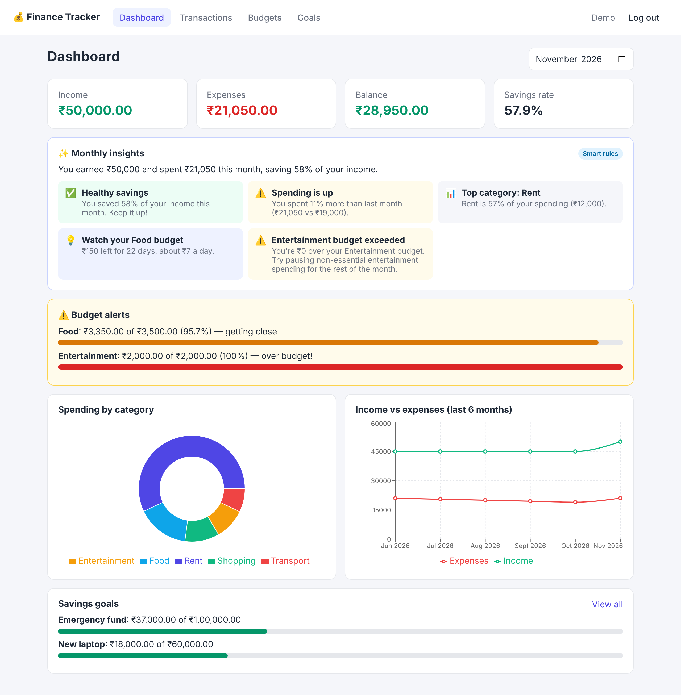
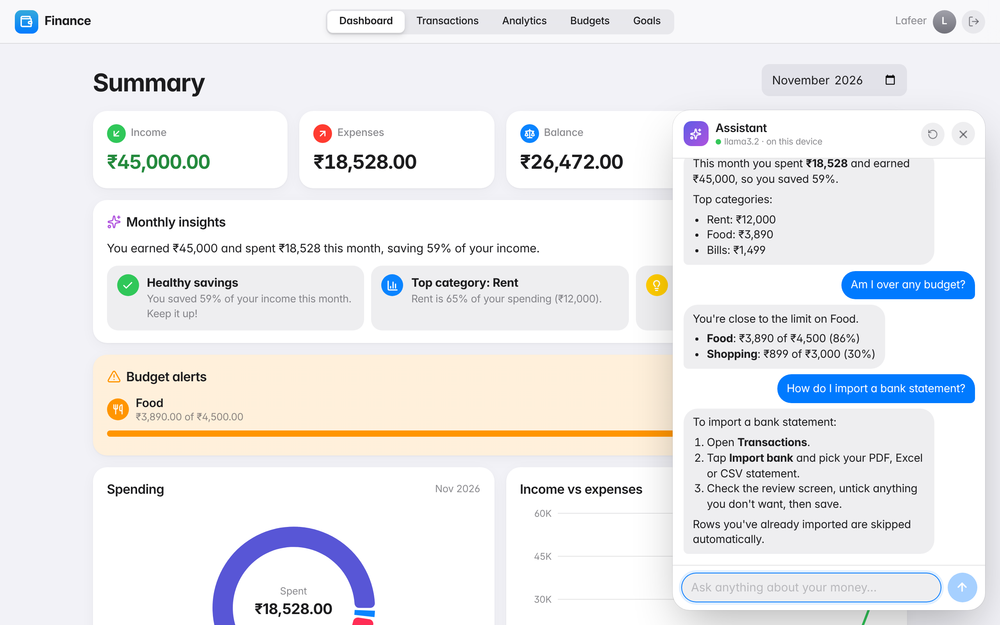
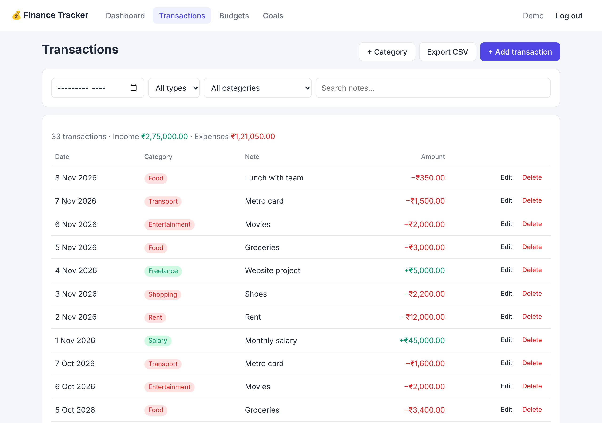
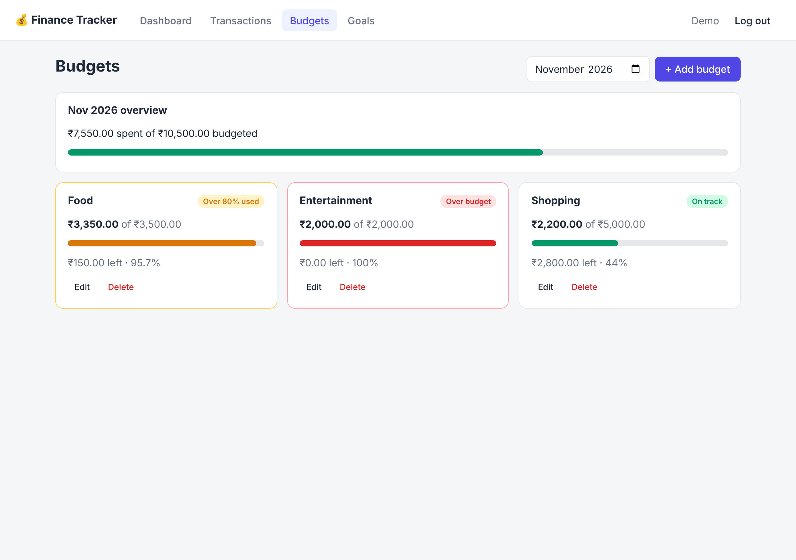
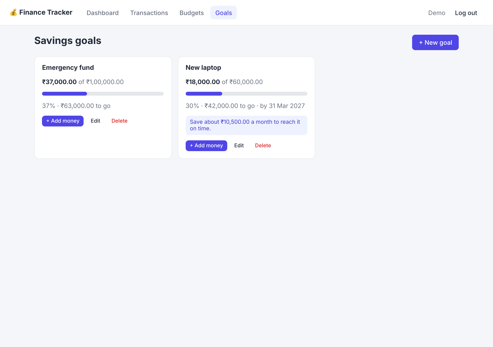
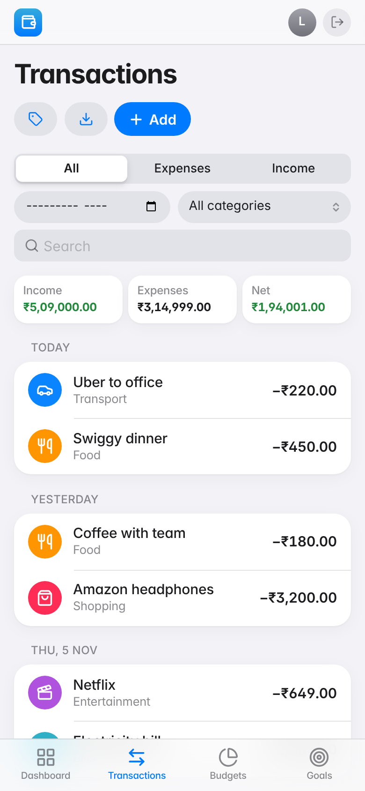
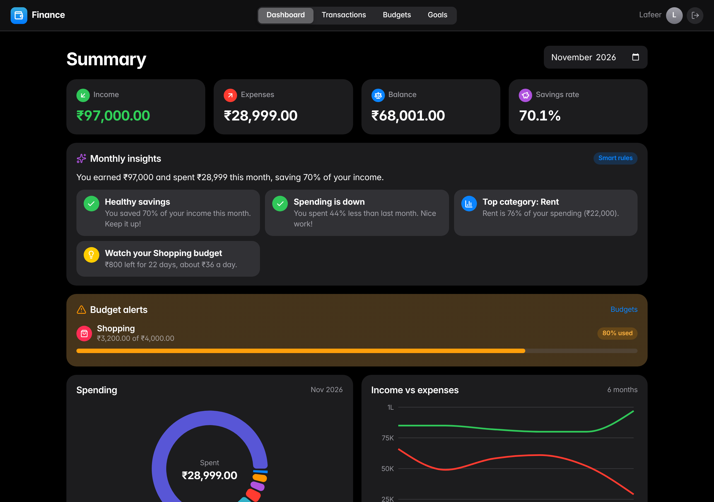
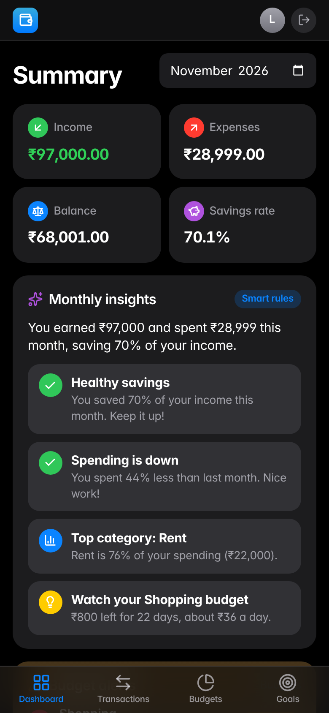
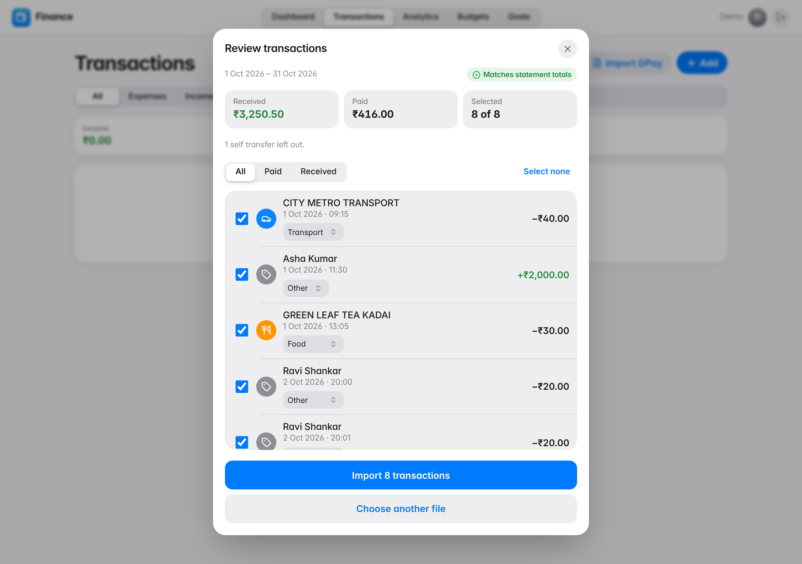
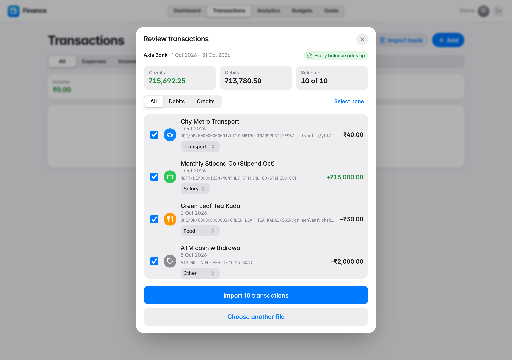

# Personal Finance Tracker

A full stack web app to record income and expenses, set monthly budgets, see spending patterns, and track savings goals.

**Stack:** React (Vite) · FastAPI · SQLAlchemy · SQLite · JWT auth · Recharts · Ollama (local AI, optional)



## Features

- **Accounts:** sign up and log in. Passwords are hashed with bcrypt and sessions use JWT tokens. Each user only ever sees their own data.
- **Transactions:** add, edit and delete income and expenses with an amount, date, category and note. Filter by month, type, category, or search notes. Export to CSV.
- **Categories:** sensible defaults are created at sign up (Food, Rent, Salary…), and you can add your own.
- **Budgets:** set a monthly limit per expense category. Each budget shows how much is spent and turns amber at 80% and red when you go over. Alerts also show on the dashboard.
- **Dashboard:** monthly income, expenses, balance and savings rate; a donut chart of spending by category; a 6‑month income vs expenses trend line.
- **Savings goals:** set a target and optional deadline, add money over time, and see progress plus how much you need to save each month to finish on time.
- **✨ Auto-categorize (AI):** type a description like "Zomato biryani" or "Uber to office" and the category is filled in for you. It also learns from how you categorized past transactions.
- **✨ AI assistant:** an **Ask AI** button on every page opens a chat. Ask things like "How much did I spend on Swiggy last month?", "Am I over any budget?" or "How do I import a bank statement?". It answers from your own transactions, budgets and goals, and knows how every screen of the app works. It runs on a local model through Ollama, so your data never leaves your computer.
- **✨ Monthly insights (AI):** the dashboard shows a short summary of your month and personalised tips: spending changes vs last month, categories that jumped, budgets at risk (with a daily allowance), savings rate, and whether you're on track for your goals.

## AI features with Ollama (local AI)

All AI in the app runs **on your own computer** through [Ollama](https://ollama.com). There is no API key, no cost, and your financial data is never sent to a cloud service.

| Feature | Without Ollama | With Ollama |
|---|---|---|
| Auto-categorize | Built-in rules (keywords + your history) | The local model picks the category |
| Monthly insights | Built-in rules, **Smart rules** badge | Written by the local model, **AI** badge |
| AI assistant chat | Shows how to start Ollama | Answers questions about your money and the app |

### Setup

1. Install Ollama from https://ollama.com/download (macOS, Windows, Linux). On Linux: `curl -fsSL https://ollama.com/install.sh | sh`
2. Download the model (about 2 GB, once):
   ```bash
   ollama pull llama3.2
   ```
3. Make sure Ollama is running. The desktop app runs it in the background; otherwise run `ollama serve` in a terminal.
4. Start the backend as usual. Open the app and click **Ask AI** at the bottom right. The header shows a green dot and the model name when it's connected.

If Ollama isn't running or the model isn't downloaded, the app keeps working: auto-categorize and insights use the built-in rules, and the assistant shows the exact command to fix it with a **Try again** button.

**Choosing a model:** `llama3.2` (3B) is a good default for most laptops. For better answers on a machine with 16 GB+ RAM, try `ollama pull qwen2.5:7b` or `llama3.1:8b` and set `OLLAMA_MODEL` to that name. The assistant works best with models that support tool calling (Llama 3.1/3.2, Qwen 2.5/3, Mistral). Models without tool support still answer from a summary of the current month.

```bash
# macOS/Linux
export OLLAMA_MODEL=qwen2.5:7b
# Windows PowerShell
$env:OLLAMA_MODEL="qwen2.5:7b"
```

### How the assistant works, and why it only sees your data

- The model never gets database access. It can only call six **read-only tools** on the backend (`get_summary`, `search_transactions`, `get_monthly_trend`, `get_budgets`, `get_goals`, `list_categories`).
- Every tool is bound to the logged-in user on the server. The model can't pass a user id, so it can't read another account's data, and it can't add, change or delete anything.
- The browser may only send the conversation's user and assistant messages, so nobody can inject a system prompt or fake tool results.
- The system prompt includes a guide to every screen of the app (for "how do I…" questions), today's date, and a short snapshot of this month.
- Answers stream back word by word, with a short status like "Searching your transactions…" while a tool runs.

The code is in `backend/app/assistant.py` (prompt and tools), `backend/app/ollama.py` (Ollama client) and `frontend/src/components/Assistant.jsx` (chat panel).



## Project structure

```
backend/
  app/
    main.py          FastAPI app, CORS, router registration
    config.py        settings (secret key, database URL) from environment variables
    database.py      SQLAlchemy engine and session
    models.py        database tables: User, Category, Transaction, Budget, Goal
    schemas.py       Pydantic models that validate requests and shape responses
    security.py      password hashing, JWT creation, current-user dependency
    services.py      shared logic: budget status, goal progress, default categories
    ai.py            auto-categorize and insights: local model + offline rules fallback
    assistant.py     AI assistant: system prompt and read-only, per-user tools
    ollama.py        client for the local Ollama server
    routers/         one file per feature: auth, categories, transactions, budgets, goals, dashboard, ai, assistant
  tests/             pytest API tests (in-memory database)
  requirements.txt
frontend/
  src/
    api.js           axios client that attaches the token
    AuthContext.jsx  login state shared across the app
    App.jsx          routes
    components/      Layout (nav bar), Modal, ProgressBar
    pages/           Login, Register, Dashboard, Transactions, Budgets, Goals
    format.js        currency and date helpers (change currency here)
```

## Running it locally

You need **Python 3.10+** and **Node.js 18+**.

### 1. Backend

```bash
cd backend
python -m venv .venv
# Windows: .venv\Scripts\activate      macOS/Linux: source .venv/bin/activate
pip install -r requirements.txt
uvicorn app.main:app --reload
```

The API runs at http://localhost:8000. Interactive API docs are at **http://localhost:8000/docs**: click *Authorize*, enter your email as the username and your password, and you can try every endpoint.

The SQLite database file `finance.db` is created automatically the first time the server starts.

### 2. Frontend

In a second terminal:

```bash
cd frontend
npm install
npm run dev
```

Open http://localhost:5173 and create an account.

If the backend runs somewhere other than `http://localhost:8000`, copy `.env.example` to `.env` and change `VITE_API_URL`.

### 3. Tests

```bash
cd backend
pytest
```

## API overview

All endpoints except register and login need an `Authorization: Bearer <token>` header.

| Method | Path | Description |
|---|---|---|
| POST | `/auth/register` | Create an account, returns a token |
| POST | `/auth/login` | Log in (form fields `username` = email, `password`) |
| GET | `/auth/me` | Current user |
| GET / POST | `/categories` | List (optional `type`) / create |
| DELETE | `/categories/{id}` | Delete an unused category |
| GET / POST | `/transactions` | List with filters `month`, `type`, `category_id`, `start`, `end`, `search` / create |
| GET / PUT / DELETE | `/transactions/{id}` | Read / update / delete |
| GET | `/transactions/export` | Download CSV (same filters) |
| GET / POST | `/budgets` | List for a `month` with spent, percent and status / create |
| PUT / DELETE | `/budgets/{id}` | Change limit / delete |
| GET / POST | `/goals` | List with progress / create |
| PUT / DELETE | `/goals/{id}` | Update / delete |
| POST | `/goals/{id}/contribute` | Add money to a goal |
| GET | `/dashboard/summary` | Month totals, spending by category, budget alerts |
| GET | `/dashboard/trends` | Income and expenses per month (`months`, `end_month`) |
| GET | `/ai/status` | Whether the local AI model is available |
| POST | `/ai/categorize` | Suggest a category for `{note, type}` |
| GET | `/ai/insights` | Summary and tips for a `month` |
| GET | `/assistant/status` | Is Ollama running and the model downloaded, with a setup message if not |
| POST | `/assistant/chat` | `{messages: [{role, content}]}`; streams the answer as newline-delimited JSON events (`status`, `token`, `error`, `done`) |

## Configuration

Set these environment variables for anything beyond local development:

| Variable | Default | Purpose |
|---|---|---|
| `SECRET_KEY` | a dev-only value | Signs JWT tokens. **Change this in production.** |
| `DATABASE_URL` | `sqlite:///./finance.db` | Database location |
| `CORS_ORIGINS` | `http://localhost:5173` | Comma-separated frontend URLs allowed to call the API |
| `CORS_ORIGIN_REGEX` | localhost / 127.0.0.1, any port | Extra allowed frontend origins for local development. Set it empty in production |
| `ACCESS_TOKEN_EXPIRE_MINUTES` | `1440` | How long a login lasts |
| `OLLAMA_URL` | `http://localhost:11434` | Where Ollama is running |
| `OLLAMA_MODEL` | `llama3.2` | Which local model to use (run `ollama pull <name>` first) |
| `OLLAMA_TIMEOUT` | `180` | Seconds to wait for an answer (the first one loads the model into memory) |
| `OLLAMA_NUM_CTX` | `8192` | Context window in tokens |
| `AI_ENABLED` | `true` | Set to `false` to always use the built-in rules and turn the assistant off |

## Screenshots

| Transactions | Budgets |
|---|---|
|  |  |

| Goals | Mobile |
|---|---|
|  |  |

| Dark mode | Mobile (dark) |
|---|---|
|  |  |


## Receipt scanning (OCR)

The Transactions page includes **Scan receipt**. Upload a JPG, PNG or WebP receipt (up to 5 MB) to extract a possible merchant, total, date and category. The extracted values are suggestions only: the user reviews and edits them in the normal transaction form and explicitly saves the transaction. Scanned images are processed in memory and are not stored by the API.

### OCR system requirement

The Python package uses Tesseract OCR, which must also be installed on the machine running the backend.

```bash
# Ubuntu / Debian
sudo apt-get install tesseract-ocr

# Arch Linux / Omarchy
sudo pacman -S tesseract tesseract-data-eng
```

Install the Python dependencies with the existing requirements file:

```bash
cd backend
pip install -r requirements.txt
```

The authenticated endpoint is `POST /receipts/scan` and accepts a multipart form field named `file`. It returns editable extraction suggestions and does not create a transaction. OCR accuracy depends on image quality and receipt layout; always verify the amount and date before saving.

## Google Pay statement import

The Transactions page includes **Import GPay**. Download a transaction statement PDF from Google Pay and upload it (up to 10 MB). The backend reads every row: **Paid to …** becomes an expense and **Received from …** becomes income. Self transfers are left out, since they are neither.

Before anything is saved you get a review screen. Each row has a suggested category (from the same keyword rules and your own history that power auto-categorize), and you can untick rows or change categories. The screen also checks that the parsed totals match the **Sent** and **Received** totals printed on the statement, so you can tell nothing was missed.

Each imported row keeps its UPI transaction ID, so uploading the same or an overlapping statement again skips rows that are already in your list. Existing databases get the new `transactions.reference` column automatically on startup.



Endpoints (both need a login token):

- `POST /statements/gpay/preview`: multipart field `file` (PDF). Returns the parsed rows with suggested categories. Saves nothing.
- `POST /statements/gpay/import`: JSON `{ "transactions": [{ date, type, amount, note, category_id, upi_id }] }`. Saves the rows and returns `{ imported, skipped_duplicates }`.

The parser lives in `backend/app/gpay_statement.py` and uses `pypdf`. Tests use a made-up statement in `backend/tests/fixtures/` (regenerate it with `make_gpay_fixture.py`).

## Bank statement import (any bank)

**Import bank** on the Transactions page reads an account statement from any bank. It is not tied to one bank's layout: it finds the columns itself from their headings (for example `Txn Date`, `Narration`, `Particulars`, `Withdrawal Amt.`, `Deposit`, `Dr / Cr`, `Closing Balance`). Debits become expenses and credits become income.

- **File types:** PDF (including password-protected PDFs, the app asks for the password and never stores it), Excel `.xlsx` and `.xls`, the HTML tables some banks download as `.xls`, CSV/TSV with any separator, and plain-text statements.
- **Layouts:** separate debit and credit columns, one amount column with a Dr/Cr column or suffix, signed amounts, dates in any common format (`01/10/26`, `01-Oct-2026`, `2026-10-01`, Excel dates), statements listed newest first, narrations wrapped over several lines, and headers repeated on every page.
- **Balance check:** when the statement has a running balance, each row's balance must follow from the previous one. The balance also decides whether a row is a debit or credit when the columns are unclear. The review screen shows "Every balance adds up", or how many gaps it found.
- **Readable notes:** narrations like `UPI/DR/412345678901/SWIGGY/YESB/swiggy@ybl/Payment` become `Swiggy`, and ATM withdrawals, interest and bank charges get plain labels. Categories are suggested from these.
- **No double counting:** each row keeps a reference, so re-uploading a statement skips rows already imported. UPI payments keep their 12-digit UPI reference, which is the same number Google Pay shows, so a payment imported from a Google Pay statement is not added again from the bank statement.



API:

- `POST /statements/bank/preview`: multipart fields `file` and optional `password`. Returns rows with suggested categories, the detected bank, and the balance check. Saves nothing. A locked PDF returns 423 with `detail.code` `password_required` or `password_wrong`.
- `POST /statements/bank/import`: same body as the Google Pay import, with `reference` instead of `upi_id`.

The reader lives in `backend/app/bank_statement.py`. Tests run the same ten made-up transactions through six bank layouts and file types (`backend/tests/fixtures/bank_*`, regenerated with `make_bank_fixtures.py`).
